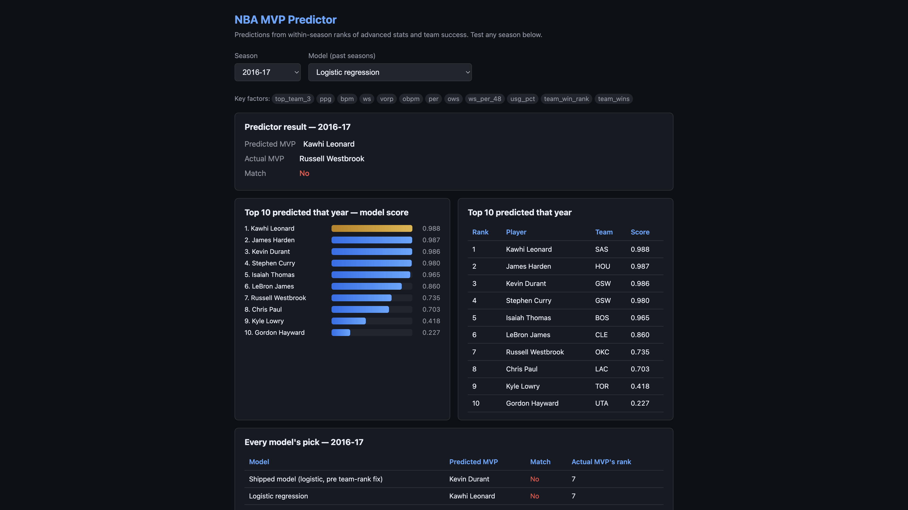

# NBA MVP Predictor

[](https://github.com/shreesh-prime/nba-mvp-model/actions/workflows/ci.yml)

[](LICENSE)

Predicts the NBA MVP from advanced stats and team success, backtested against every MVP race since 1995-96, with a live prediction for the current season that refreshes daily.

**Live demo:** _coming soon_



## How it works

1. **Data.** Player-season advanced stats (PER, WS, WS/48, BPM, OBPM, VORP, usage), per-game scoring, team wins, and MVP voting results are scraped from [Basketball Reference](https://www.basketball-reference.com/) and cached in `data/`.
2. **Peer-relative features.** Each stat is converted to a **within-season percentile rank**, because voters compare players against that year's league, not against other eras. Team success enters as team-wins rank and a top-3-seed flag.
3. **Models.** Four models are trained and compared:
   - **Shipped model**: logistic regression on "won MVP or not". This is the model behind the live prediction.
   - **Logistic regression**: the same model retrained after a team-rank bug fix (see below).
   - **Vote-share Ridge (percentile ranks)**: Ridge regression on each player's actual MVP award share.
   - **Vote-share Ridge (log-top ranks)**: the same, but ranks are log-transformed so the gap between #1 and #5 in the league counts for more than the gap between #100 and #105.
   - **Ensemble**: within-season z-score blend of logistic P(MVP), Ridge vote-share, and raw VORP. This is the strongest exact-winner model.
4. **Backtest.** Leave-one-season-out: for each season, train on every other season and predict that one.

## Backtest results (1995-96 to 2024-25, 30 seasons)

| Model | Exact MVP | MVP in top 3 | MRR | Avg. rank of real MVP | Vote-order match |
|---|---|---|---|---|---|
| **Ensemble (logistic + Ridge + VORP)** | **22/30** | **27/30** | **0.830** | **1.93** | 0.690 |
| Shipped model (logistic, pre team-rank fix) | 20/30 | 26/30 | 0.783 | 1.97 | 0.665 |
| Logistic regression | 19/30 | 26/30 | 0.770 | 2.03 | 0.674 |
| Vote-share Ridge (percentile ranks) | 20/30 | 24/30 | 0.743 | 4.30 | 0.505 |
| Vote-share Ridge (log-top ranks) | 17/30 | 28/30 | 0.742 | 2.87 | 0.704 |

- **MRR** (mean reciprocal rank) averages 1 / (the rank the model gave the real MVP), so 1.0 means it always ranked the winner first.
- **Vote-order match** is the Spearman correlation between predicted scores and actual vote shares among players who received votes.
- Full per-season results are in `data/backtest_results*.csv` and `data/backtest_summary.json`. The app's **Model** menu shows every model's pick for any past season.
- **Why not 25/30?** The remaining ensemble misses are the seasons where voters rewarded a story the box score does not contain: Malone 1997 (fatigue after Jordan), Iverson 2001, Nash 2005–06 (Suns turnaround), Kobe 2008, Rose 2011, Curry 2015 (over Harden's WS/VORP lead), Westbrook 2017. An oracle that could pick the best of these models after seeing the answer only reaches 25 by mixing contradictory specialists; no single model, and no blend that is allowed to look only at stats, gets there. Nash 2005–06 in particular is missed by every variant.

**The team-rank fix.** An earlier version ranked team wins across *player rows* instead of across teams, so a 64-win team with many rostered players could rank 14th. The fixed feature ranks teams only. The shipped model was trained before the fix; its score partly came from the broken feature, which is why the retrained logistic model scores slightly lower.

### Seasons the shipped model gets wrong

| Season | Actual MVP | Model's pick | Why it's hard |
|---|---|---|---|
| 1996-97 | Karl Malone | Michael Jordan | Voter fatigue: Jordan had stronger numbers |
| 1997-98 | Michael Jordan | Karl Malone | The reverse of the year before |
| 2000-01 | Allen Iverson | Shaquille O'Neal | Narrative and scoring title over efficiency |
| 2001-02, 2002-03 | Tim Duncan | Shaquille O'Neal, Dirk Nowitzki | Close races between similar profiles |
| 2004-05, 2005-06 | Steve Nash | Dirk Nowitzki, Chauncey Billups | Nash's value was largely team improvement, which box-score metrics underrate |
| 2007-08 | Kobe Bryant | Kevin Garnett | Career-arc narrative |
| 2016-17 | Russell Westbrook | Kevin Durant | The triple-double season; voters rewarded the story over team success |
| 2021-22 | Nikola Jokić | Giannis Antetokounmpo | Very close race |

## Quickstart

```bash
git clone https://github.com/shreesh-prime/nba-mvp-model.git
cd nba-mvp-model
python3 -m venv .venv && source .venv/bin/activate
pip install -r requirements.txt

python3 app.py                 # web app on http://localhost:8080
```

The repo ships with cached data and trained models, so the app works immediately. To rebuild:

```bash
python3 mvp_model.py                       # train + backtest all model variants
python3 mvp_model.py backtest --variant logtop
python3 predict_mvp.py --variant logistic  # print the current-season top 10
python3 update_data.py                     # refresh data/current_season_prediction.json
```

The current season is derived from today's date (a new season starts on October 1), so nothing needs editing each year.

## Development

```bash
pip install -r requirements-dev.txt
ruff check .
pytest -q
```

Tests run offline (network access is blocked in `tests/conftest.py`). CI runs both on every push and pull request.

## Project structure

```
app.py                 Flask app (season + model menus, backtest comparison, JSON API)
mvp_model.py           Features, model variants, leave-one-season-out backtest, training CLI
predict_mvp.py         Current-season prediction from a saved model
update_data.py         Daily refresh of the current-season prediction
season_utils.py        Current-season helpers
data/fetch_data.py     Basketball Reference scraping (rate-limited) and dataset builders
data/                  Cached stats, MVP voting, backtest results, formulas
model/                 Shipped model; model/<variant>/ for each variant
tests/                 pytest suite
.github/workflows/     CI and the daily prediction refresh
```

## API

- `GET /api/<season>`: backtest result for a past season (predicted MVP, actual MVP, top 10), or the live prediction for the current season. `/api/season/<season>` is an alias.

## Deployment

- **Render:** the repo includes `render.yaml`. In Render, choose New, then Blueprint, and pick this repo. It runs `gunicorn app:app` on the free plan.
- **Docker:** `docker build -t nba-mvp . && docker run -p 8080:8080 nba-mvp`
- **Daily refresh:** `.github/workflows/update-predictions.yml` runs `update_data.py` every day and commits the new prediction when it changes. Enable *Read and write* workflow permissions under Settings, then Actions, in the GitHub repo. In the offseason it skips quietly.

## Limitations

- Voters weigh narrative, voter fatigue and availability, which box-score stats can't capture. Most misses above are of that kind.
- Live predictions use the shipped model. Current-season predictions require 20 games played, while training uses 41.
- Data comes from Basketball Reference. Requests are rate-limited and results are cached to respect their [terms of use](https://www.sports-reference.com/termsofuse.html). Please keep it that way if you fork this.

## License

[MIT](LICENSE)
